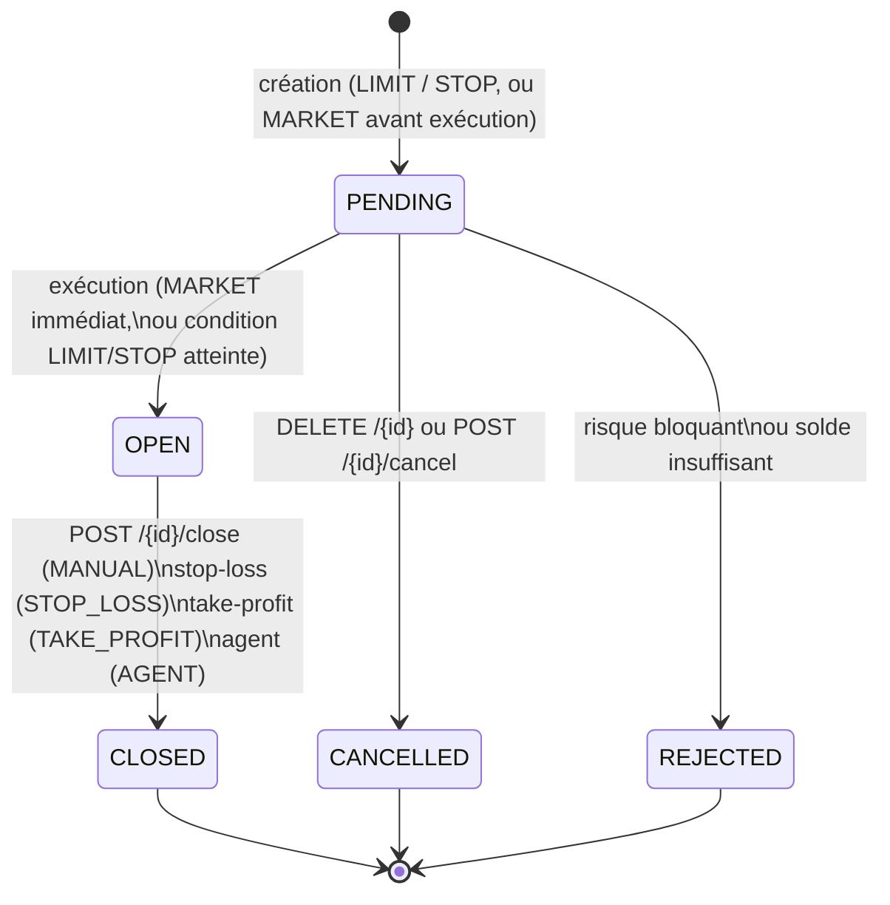

# Module 2 — Trading & Gestion du Risque

Moteur de trading du simulateur MarketSim AI : exécution des ordres au prix serveur, portefeuille virtuel,
contrôle du risque avant chaque ordre, déclenchement automatique des stop-loss / take-profit / ordres LIMIT et STOP.

- Back : package `tn.esprit.marketsim.trading`
- Front : `src/modules/trading/` (`TradingPage.tsx`, `tradingLogic.ts`) et `src/api/endpoints.ts`

## 1. Modèle « ticket / lot »

Un ordre exécuté (`TradeOrder`) est **une position ouverte indépendante** :

| Sens | Position | Ouverture | Clôture |
|------|----------|-----------|---------|
| BUY  | LONG  | solde −= qte × prix + frais | solde += qte × prixSortie − frais |
| SELL | SHORT (marge 100 %) | solde −= qte × prix + frais (marge bloquée) | solde += marge + (entrée − sortie) × qte − frais |

- Frais : `trading.fee-rate` (0,1 %) appliqués **à l'ouverture et à la clôture**.
- P&L réalisé (`realizedPnl`) : brut, hors frais. `fees` = frais d'ouverture + frais de clôture.
- **Invariant** (testé sur 2 000 tickets aléatoires, `TradeAccountingTest`) :
  `variation du solde sur la vie du ticket = realizedPnl − fees`.
- **Equity** = solde + Σ LONG ouverts (qte × prixActuel) + Σ SHORT ouverts (marge + (entrée − prixActuel) × qte).
- Montants en `BigDecimal` : prix et quantités à 6 décimales, montants à 2, `RoundingMode.HALF_UP`.
- Le **prix n'est jamais lu dans la requête** : il vient de `PriceProvider` (implémentation : `Asset.price`).

## 2. Cycle de vie d'un ordre



- Toute autre transition → **409 Conflict** (`OrderStateMachine.transition`). Exemples : clôturer deux fois,
  annuler une position OPEN (message « utilisez /close »), modifier un ordre CLOSED.
- **Aucune suppression physique** : `DELETE /{id}` annule un PENDING ; l'historique est conservé.
- Un ordre refusé est **enregistré** en REJECTED avec `rejectReason` (historique, audit) et la réponse est un 400.

### Règles de déclenchement (`OrderTriggerEngine`, classe pure)

| Ordre | Condition | Exécution |
|-------|-----------|-----------|
| LIMIT BUY | prix ≤ limite | au prix observé |
| LIMIT SELL | prix ≥ limite | au prix observé |
| STOP BUY | prix ≥ niveau | au prix observé |
| STOP SELL | prix ≤ niveau | au prix observé |
| LONG ouvert | prix ≤ SL → STOP_LOSS ; prix ≥ TP → TAKE_PROFIT | clôture au prix observé |
| SHORT ouvert | prix ≥ SL → STOP_LOSS ; prix ≤ TP → TAKE_PROFIT | clôture au prix observé |

Si SL et TP sont franchis en même temps (saut de prix), le stop-loss l'emporte (hypothèse prudente).
LIMIT / STOP sont évalués **dès la création** : si la condition est déjà vraie, exécution immédiate.
Pas de réservation de solde pour un PENDING : le solde est revérifié au remplissage (sinon REJECTED).

Validation SL/TP : LONG → SL < entrée < TP ; SHORT → TP < entrée < SL (entrée = prix courant pour MARKET,
`limitPrice` pour LIMIT/STOP).

### Moteur (`OrderTriggerService`)

- Balayage toutes les `trading.engine.interval-ms` (2 s) sur un **thread dédié** `trading-engine`.
- Balayage **à la demande** de l'utilisateur dans `GET /orders`, `GET /orders/{id}` et `GET /portfolio`.
- Pré-filtre sans verrou ; chaque ticket déclenché est traité dans **sa propre transaction**
  (`processTrigger`, `REQUIRES_NEW`) qui verrouille le compte, relit le ticket et réévalue la condition :
  idempotent, un échec n'arrête pas les autres tickets.

### Concurrence

- Tous les mouvements de solde : `SELECT … FOR UPDATE` sur le compte (`TradingUserRepository.findByIdForUpdate`).
- `@Version` sur `TradeOrder` : une double exécution / clôture concurrente échoue (409 ou ignorée par le moteur).

## 3. Endpoints

Tous authentifiés (JWT). L'utilisateur vient toujours du token ; un ordre d'un autre utilisateur → 404.

| Méthode | URL | Rôle | Codes |
|---------|-----|------|-------|
| GET | `/api/trading/orders?status=&symbol=&from=&to=` | Liste (toujours un tableau, dates `yyyy-MM-dd` incluses) | 200 |
| GET | `/api/trading/orders/{id}` | Détail | 200, 404 |
| POST | `/api/trading/orders` | Créer : `{symbol, side, orderType, quantity, limitPrice?, stopLoss?, takeProfit?}` | 200, 400 (saisie invalide, ordre refusé) |
| PUT | `/api/trading/orders/{id}` | SL/TP partiel : `{stopLoss?, takeProfit?, clearStopLoss?, clearTakeProfit?}` | 200, 400, 404, 409 |
| POST | `/api/trading/orders/{id}/close` | Clôture au prix courant (MANUAL) | 200, 404, 409 |
| POST | `/api/trading/orders/{id}/cancel` | Annule un PENDING | 200, 404, 409 |
| DELETE | `/api/trading/orders/{id}` | Idem cancel (aucune suppression) ; OPEN → 409 | 200, 404, 409 |
| GET | `/api/trading/portfolio` | Cash, equity, expositions, P&L, rendement, positions par symbole | 200 |
| GET | `/api/trading/portfolio/history` | Courbe d'equity (un point par exécution / clôture) | 200 |
| POST | `/api/trading/risk/assess` | Simulation à blanc : `{symbol, side, orderType, quantity, limitPrice?, stopLoss?}` | 200, 400 |
| GET | `/api/trading/risk/portfolio` | VaR 95/99, CVaR 95, expositions, HHI, diversification, drawdown | 200 |

Réponse d'un ordre refusé (400) : `{ "status": 400, "message": "<raison>", "order": { …ticket REJECTED… } }`.
Champs envoyés par le client et ignorés : `price`, `status`, `owner` (absents des DTO).

## 4. Gestion du risque

### Score d'un ordre (0-100, déterministe — `RiskCalculator`)

Somme pondérée de 5 composantes normalisées dans [0, 1] :

| Composante | Poids | Normalisation |
|-----------|-------|---------------|
| Concentration | 30 | exposition du symbole après ordre / equity ÷ `max-symbol-concentration-pct` |
| Taille de l'ordre | 25 | notional / equity ÷ `max-position-pct` |
| Volatilité de l'actif | 20 | σ annuelle ÷ 80 % |
| Exposition brute | 15 | exposition brute après ordre / equity |
| Liquidité restante | 10 | 1 − liquidités après ordre / equity |

`score = arrondi(30·c + 25·t + 20·v + 15·e + 10·l)` ; **LOW** < 35 ≤ **MEDIUM** ≤ 65 < **HIGH** ;
**BLOCKED** si une règle dure échoue (score toujours calculé, pour l'explication).

Exemple : 10 AAPL à 192,45 sur un compte neuf → score 11 (LOW).

### Règles dures (ordre refusé → REJECTED)

| Règle | Paramètre (défaut) |
|-------|--------------------|
| Solde ≥ notional + frais | — |
| notional / equity ≤ | `trading.risk.max-position-pct` (25 %) |
| exposition du symbole après ordre / equity ≤ | `trading.risk.max-symbol-concentration-pct` (40 %) |
| liquidités après ordre / equity ≥ | `trading.risk.min-cash-reserve-pct` (5 %) |
| tickets OPEN + PENDING après ordre ≤ | `trading.risk.max-open-positions` (20) |

Un ordre HIGH **sans stop-loss** produit un avertissement (`STOP_LOSS_ADVISED`, non bloquant).
Le contrôle s'applique aux ordres de l'utilisateur **et** de l'agent IA.

### VaR / CVaR

- **Ordre** : VaR 95 % à 1 jour = quantile historique des rendements réels (inversés pour un SHORT,
  `Stats.valueAtRisk`), sinon paramétrique `1,645 × σ_jour × notional`.
- **Portefeuille** (expositions signées : LONG +, SHORT −) :
  - **historique** si tous les actifs ouverts ont une série réelle : P&L journaliers `Σ eᵢ·rᵢ,t` sur les dates
    communes (250 séances max, 60 minimum), puis `Stats.valueAtRisk` / `Stats.expectedShortfall` ;
  - sinon **paramétrique normale** : `σp² = Σᵢ Σⱼ ρᵢⱼ eᵢ eⱼ σᵢ σⱼ` avec **corrélation constante**
    `ρ = trading.risk.default-correlation` (0,5) entre actifs différents ; VaR95 = 1,645 σp, VaR99 = 2,326 σp,
    CVaR95 = 2,063 σp. *Hypothèse simplificatrice* : une seule corrélation pour toutes les paires.
- **Concentration** : HHI des expositions brutes (1 = une seule ligne) ; diversification = (1 − HHI)/(1 − 1/n) × 100.
- **Drawdown** : max et courant sur la courbe d'equity (`EquitySnapshot`), précédée du capital initial.

### Volatilité (`VolatilityService`)

1. Série réelle déjà en base (`market_series`, module 6 : Yahoo Finance ou CSV), 250 dernières séances.
2. Sinon σ par classe d'actif (`AssetDynamics`) **immédiatement**, et téléchargement en tâche de fond
   (au plus 1 tentative / symbole / heure). La requête n'attend jamais le réseau : hors ligne, repli instantané.
3. Cache mémoire 30 min.

## 5. Intégration avec les autres modules

- **Module 6 (agent)** : `DecisionService.execute` appelle `TradeOrderService.placeForAgent`.
  BUY → ticket LONG ; SELL → clôture du ticket LONG OPEN **le plus ancien** sur ce symbole (closeReason = AGENT),
  sinon ouverture d'un SHORT. Un refus donne un ticket REJECTED (jamais d'exception) : la décision est enregistrée
  avec l'id de ce ticket.
- **Registre d'audit** : `ORDER_PLACED`, `ORDER_FILLED`, `ORDER_CLOSED`, `ORDER_REJECTED`, `ORDER_CANCELLED`
  (`TradingAudit`). Écriture **après le commit**, dans une transaction séparée, exceptions journalisées :
  une panne du registre ne bloque jamais un ordre.
- **Module 1** : `UserLevelFeatureExtractor` lit toujours `findByOwnerIdOrderByCreatedAtDesc` (inchangé).

## 6. Paramètres (`application.properties`)

```properties
trading.fee-rate=0.001
trading.initial-capital=100000
trading.risk.max-position-pct=25
trading.risk.max-symbol-concentration-pct=40
trading.risk.min-cash-reserve-pct=5
trading.risk.max-open-positions=20
trading.risk.default-correlation=0.5
trading.engine.enabled=true
trading.engine.interval-ms=2000
trading.engine.initial-delay-ms=10000
```

## 7. Migration des bases existantes (`TradingSchemaMigration`)

`ddl-auto=update` ajoute les colonnes mais ne modifie pas les colonnes existantes. Au démarrage (MySQL/MariaDB) :
`status ENUM → VARCHAR(20)` (sinon PENDING/REJECTED seraient refusés), `price/quantity/stop_loss/take_profit
DECIMAL(38,2) → DECIMAL(19,6)`, `version = 0`, et les anciens tickets OPEN/CLOSED reçoivent
`executedPrice = price`, `executedAt = createdAt`, `fees = 0`, `legacy = true`. Un ticket **legacy** n'a jamais
débité le solde : à sa clôture seul `P&L − frais` est crédité (pas le principal). Idempotent.

## 8. Limites connues

- **Prix statiques** : `Asset.price` n'évolue que si le module 5 (ou l'admin via `PUT /api/market/assets/{id}`)
  le modifie. Le bandeau live (`MarketTickerService`) n'est pas utilisé : symboles différents (« OR » vs « GOLD »),
  appels HTTP bloquants (8 s), cache 60 s. Brancher une autre source = une nouvelle implémentation de `PriceProvider`.
- Exécution au prix observé, sans slippage ni carnet d'ordres ; pas de liquidation forcée sur marge.
- `avgEntryPrice` d'une position mixte LONG + SHORT est la moyenne pondérée de tous les tickets du symbole.
- Corrélation constante dans la VaR paramétrique ; VaR historique seulement si **toutes** les séries existent.
- Le planificateur Spring partagé n'a qu'un thread (bloqué par les appels réseau d'autres modules) : le moteur
  utilise donc son propre thread.
- `@Lock(PESSIMISTIC_WRITE)` génère `FOR UPDATE OF alias`, refusé par MariaDB 10.4 : requête native `FOR UPDATE`.
- Les tickets REJECTED comptent dans le nombre d'ordres du niveau de trader (module 1).

## 9. Tests

`src/test/java/tn/esprit/marketsim/trading/` (sans base de données) :
`OrderStateMachineTest`, `OrderRulesTest`, `TradeAccountingTest` (invariant), `TradeOrderServiceTest`
(prix client ignoré, symbole inconnu, PUT partiel, 404 autre utilisateur, rejet, LIMIT, agent, legacy, risque),
`OrderTriggerEngineTest`, `OrderTriggerServiceTest`, `PortfolioCalculatorTest`, `RiskCalculatorTest`.
Front : `npm run test:logic` (section « module 2 trading »).
